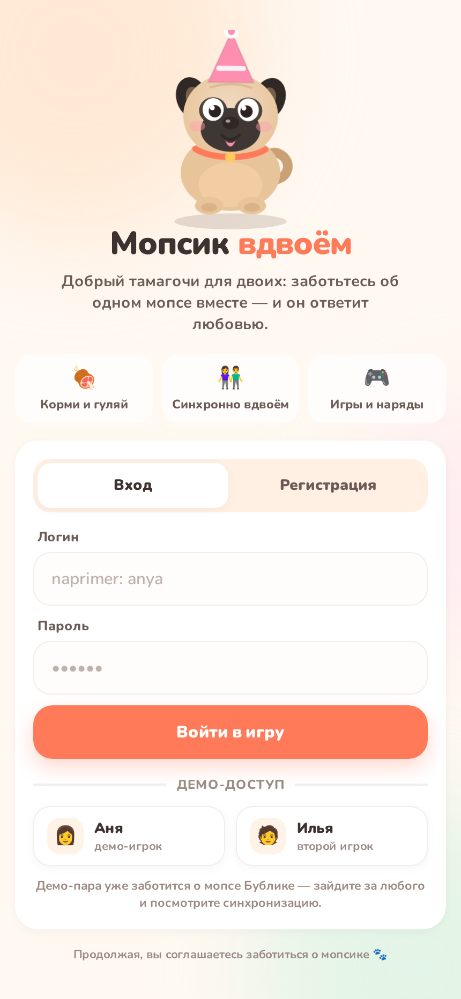
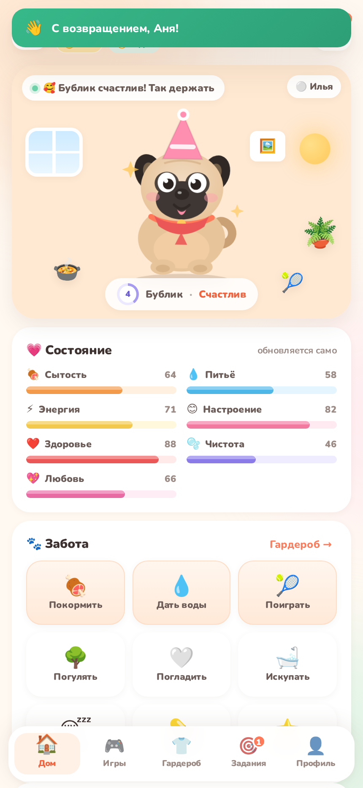
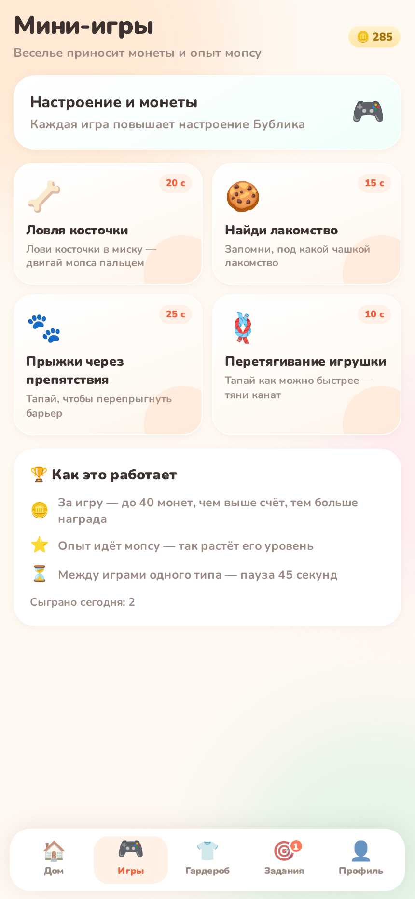
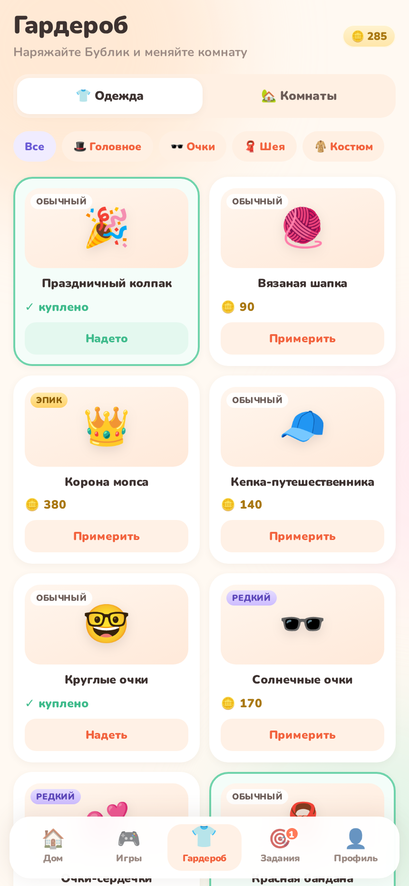
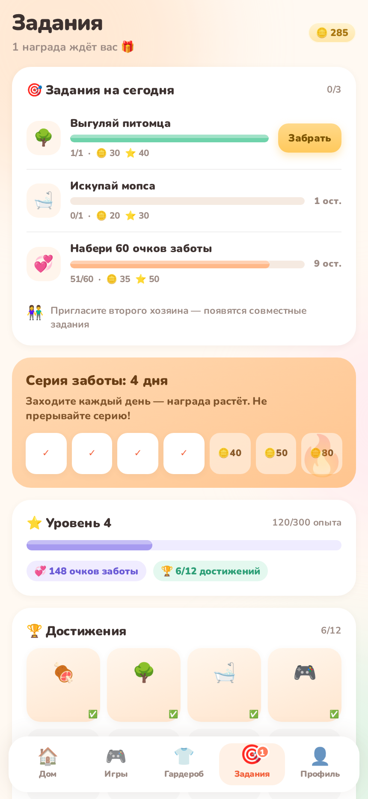
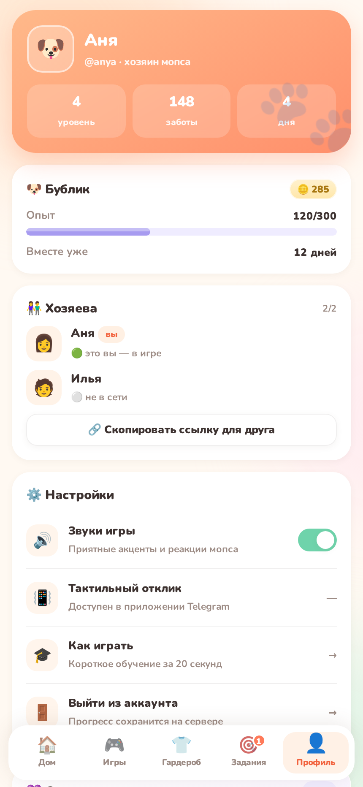
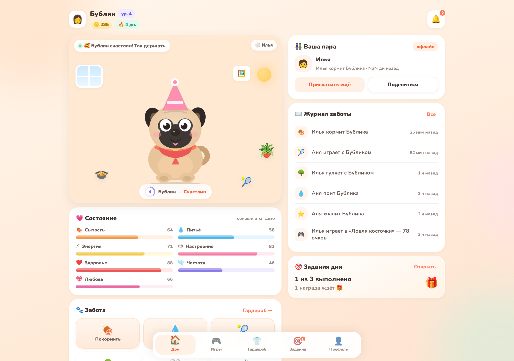
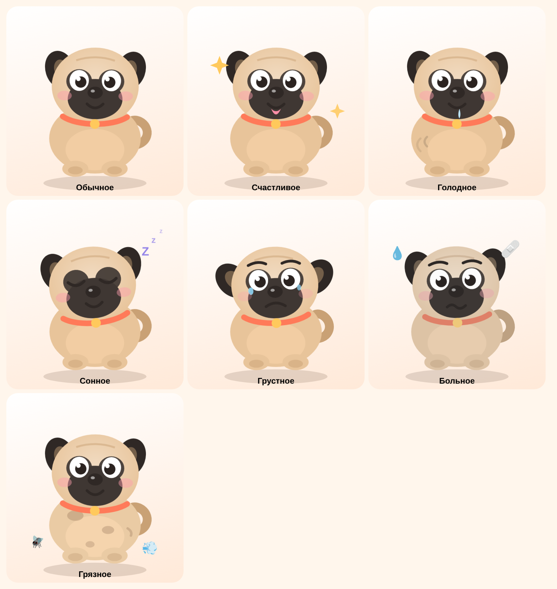

# 🐶 Мопсик вдвоём

Кооперативный тамагочи для двоих: Telegram Mini App + обычная браузерная игра.
Два игрока заботятся об одном мопсе — кормят, поят, гуляют, играют, наряжают —
и видят изменения друг друга **в реальном времени**.

<p align="center">
  
  
  
  
</p>
<p align="center">
  
  
  
</p>

---

## Как выглядит мопс

<p align="center">
  
</p>

Один и тот же векторный мопс используется на главном экране, в гардеробе и в обучении.
Состояние приходит с сервера, одежда — из инвентаря питомца, анимации — CSS-классы.

| Состояние | Когда включается | Как выглядит |
| --- | --- | --- |
| Обычное | всё в норме | спокойная мордочка |
| Счастливое | настроение ≥ 75 и показатели высокие | язык, искры, подпрыгивание |
| Голодное | сытость или питьё < 28 | слюнки и «урчание» в животе |
| Сонное | энергия < 25 или уложили спать | закрытые глаза, Zzz |
| Грустное | настроение < 38 | брови домиком, слёзы |
| Больное | здоровье < 35 | волнистый рот, пластырь, испарина |
| Грязное | чистота < 28 | пятна на боках, муха и пыль |

**Интерактивная галерея** (все состояния, 4 окраса, 14 нарядов, анимации):
[`docs/pug-gallery.html`](docs/pug-gallery.html) — открывается прямо в браузере, без сервера.
Пересобрать: `node docs/build-pug-gallery.mjs`.

---

## Быстрый старт

```bash
cd mopsy
npm start            # зависимостей нет — нужен только Node.js 18+
# → http://localhost:3000
```

Откроется экран входа. Два способа попробовать сразу:

1. **Демо-доступ** — кнопки «Аня» и «Илья». Демо-пара уже заботится о мопсе
   **Бублике** (4 уровень, журнал, достижения, надетые вещи).
   Зайдите за Аню в одном окне и за Илью в другом — увидите синхронизацию:
   действие одного мгновенно появляется у другого.
2. **Регистрация** — обычный логин/пароль, затем короткое обучение (3 экрана),
   создание мопса и приглашение второго игрока по коду.

Сбросить данные и заново засеять демо:

```bash
npm run reset        # очистить базу
npm run seed         # создать Аню, Илью и Бублика
```

---

## Что реализовано (первая версия)

### Авторизация и пара
- [x] Вход через Telegram WebApp (`initData` + HMAC-проверка на сервере)
- [x] Браузерная регистрация и вход по логину/паролю (scrypt, сессии 60 дней)
- [x] Демо-профили для показа и тестов
- [x] Создание мопса, приглашение по 6-символьному коду и по ссылке `?invite=CODE`
- [x] Максимум **два** владельца у питомца (проверка на сервере + триггер в Postgres)
- [x] Играть одному можно — партнёр присоединяется позже, прогресс общий

### Мопс
- [x] Мультяшный SVG-мопс с анимациями: дыхание, моргание, виляние хвостом,
      прыжок, еда, питьё, игра, купание, сон, грусть, лечение
- [x] Состояния: обычное, счастливое, голодное, сонное, грустное, больное, грязное
- [x] 4 окраса, имя, уровень, опыт, очки заботы, серия дней
- [x] Реакция на действия: пропсы (миска, мяч, пузыри, сердечки) + звуки

### Показатели (все 0–100, красивые прогресс-бары)
Сытость · Питьё · Энергия · Настроение · Здоровье · Чистота · Любовь
— убывают в реальном времени, в том числе пока никто не в игре (до 36 часов оффлайна),
сон восстанавливает энергию, критические показатели бьют по здоровью.

### Действия
Покормить · Дать воды · Поиграть · Погулять · Погладить · Искупать ·
Уложить спать · Полечить · Похвалить · Переодеть · Купить игрушку/аксессуар.
У каждого — свой кулдаун, стоимость энергии и награда (опыт, монеты, очки заботы).

### Совместная механика
- [x] Общее состояние: оба игрока видят один и тот же снапшот
- [x] Лента «кто последним взаимодействовал» + журнал действий с временем
- [x] Тосты и уведомления о действиях партнёра, статус «онлайн»
- [x] Серверная очередь действий исключает конфликты одновременных нажатий
- [x] Совместное задание «Забота вдвоём» (оба сделали действие за день)

### Мини-игры (10–25 с, награда на сервере)
🦴 Ловля косточки · 🍪 Найди лакомство · 🐾 Прыжки через препятствия · 🪢 Перетягивание игрушки

### Прогресс и экономика
- [x] Уровни и опыт, монеты, очки заботы
- [x] Ежедневные задания (3 в день, детерминированно одинаковые для двоих)
- [x] Серия дней совместной заботы + растущая награда за вход (7-дневный цикл)
- [x] 12 достижений с наградами
- [x] 14 предметов одежды (шапки, очки, банданы, костюмы) и 5 фонов комнаты
- [x] Покупка с предпросмотром на мопсе, надевание/снятие, отдельная смена комнаты

### Интерфейс
- [x] Мобильный приоритет (320–430 px), safe-area, десктопная двухколоночная раскладка
- [x] Навигация: Дом · Игры · Гардероб · Задания · Профиль
- [x] Loading-скелетоны, экран ошибки с повтором, пустые состояния
- [x] Звуки на WebAudio (без файлов) + переключатель «без звука»
- [x] Онбординг из 3 экранов для первого запуска
- [x] Локальный шрифт Nunito — одинаковый вид на всех устройствах и офлайн

---

## Структура проекта

```
mopsy/
├── package.json            # без зависимостей, npm start
├── public/                 # фронтенд (ES-модули, без сборки)
│   ├── index.html
│   ├── styles.css          # дизайн-система
│   ├── pug.css             # анимации мопса и пропсов
│   ├── fonts/              # Nunito (woff2, локально)
│   └── js/
│       ├── app.js          # точка входа: загрузка, роутер, SSE
│       ├── core.js         # состояние клиента и действия
│       ├── api.js          # fetch-обёртка + идемпотентность
│       ├── ui.js           # тосты, модалки, бары, утилиты
│       ├── sfx.js          # звуки на WebAudio
│       ├── pug.js          # SVG-мопс и слоты одежды
│       ├── catalog.js      # темы комнат, цвета, тексты обучения
│       └── views/          # auth, onboarding, home, games, wardrobe, tasks, profile
├── server/
│   ├── index.js            # HTTP-сервер, роуты, статика, rate-limit
│   ├── engine.js           # игровые правила и снапшоты
│   ├── content.js          # баланс и контент
│   ├── store.js            # хранилище (JSON, атомарная запись)
│   ├── auth.js             # пароли, сессии, Telegram initData
│   ├── realtime.js         # SSE-хаб
│   └── seed.js             # демо-данные
├── data/db.json            # база MVP (создаётся автоматически)
├── sql/
│   ├── schema.sql          # PostgreSQL-схема: users, pets, pet_owners, pet_stats,
│   │                       # actions, inventory, clothes, achievements, daily_tasks, notifications
│   └── seed.sql            # демо-данные для Postgres
└── docs/
    ├── BACKEND.md          # архитектура, API, баланс, переезд на Postgres/Supabase
    ├── ПУБЛИКАЦИЯ.md       # публикация «для чайника»: 7 шагов, без команд и терминала
    ├── DEPLOY.md           # та же публикация технически подробно (VPS, Docker, Render)
    ├── TELEGRAM.md         # особенности Mini App: SDK, уведомления, безопасность
    ├── telegram/           # готовые ассеты: аватар бота и баннер 640×360
    ├── pug-gallery.html    # самодостаточная галерея мопса (открыть в браузере)
    ├── build-pug-gallery.mjs
    └── screens/            # скриншоты
```

---

## API (кратко)

```
POST /api/auth/register | login | telegram | demo | logout
GET  /api/bootstrap                      # профиль + каталог + снапшот питомца
POST /api/pets                           # создать мопса
POST /api/pets/join                      # присоединиться по коду
GET  /api/pets/:id/stream                # SSE: state / pulse / presence
POST /api/pets/:id/action                # {type, idempotencyKey}
POST /api/pets/:id/game                  # {game, score, idempotencyKey}
POST /api/pets/:id/buy | equip | room    # гардероб и комнаты
POST /api/pets/:id/task                  # забрать награду за задание
POST /api/pets/:id/read                  # прочитать уведомления
GET  /api/health
```

Подробности, коды ошибок и правила баланса — в [docs/BACKEND.md](docs/BACKEND.md).

---

## Переменные окружения

| Переменная | По умолчанию | Назначение |
| --- | --- | --- |
| `PORT` | `3000` | порт HTTP-сервера |
| `HOST` | `0.0.0.0` | интерфейс прослушивания |
| `TELEGRAM_BOT_TOKEN` | — | включает строгую проверку `initData` |
| `TELEGRAM_BOT_USERNAME` | — | из него собираются ссылки-приглашения `t.me/…` |
| `TELEGRAM_APP_SHORT_NAME` | — | short name Mini App для deep links |
| `DEMO_MODE` | `1` | `0` — скрыть и отключить демо-аккаунты (перед публикацией) |
| `DB_FILE` | `data/db.json` | путь к файлу базы MVP |

Скопируйте `.env.example` → `.env` (проект читает переменные из окружения,
`dotenv` не нужен: используйте `env $(cat .env | xargs) npm start` или панель хостинга).

---

## Запуск локально

```bash
# 1. Node.js 18.17+ (проверено на 20.x)
node -v

# 2. Запуск
cd mopsy && npm start

# 3. Режим разработки с автоперезагрузкой
npm run dev
```

Телефон в той же сети: `http://<ip-компьютера>:3000` (сервер слушает `0.0.0.0`).

---

## Публикация

### Вариант A. Любой VPS + systemd (5 минут)

```bash
# на сервере
git clone <repo> && cd mopsy
sudo apt install -y nodejs nginx certbot python3-certbot-nginx
sudo systemctl enable --now node-mopsy   # unit ниже
```

`/etc/systemd/system/node-mopsy.service`:

```ini
[Unit]
Description=Mopsy Duo
After=network.target

[Service]
WorkingDirectory=/var/www/mopsy
Environment=PORT=3000
Environment=TELEGRAM_BOT_TOKEN=123456:AA...
ExecStart=/usr/bin/node server/index.js
Restart=always

[Install]
WantedBy=multi-user.target
```

Nginx (с поддержкой SSE):

```nginx
server {
  server_name mopsy.example.com;

  location / {
    proxy_pass http://127.0.0.1:3000;
    proxy_http_version 1.1;
    proxy_set_header Host $host;
    proxy_set_header X-Real-IP $remote_addr;
    proxy_buffering off;          # важно для SSE
    proxy_read_timeout 3600s;
  }
}
```

HTTPS: `sudo certbot --nginx -d mopsy.example.com`.

### Вариант B. Render / Railway / Fly.io

* Build command: `npm install` (зависимостей нет — команда пройдёт мгновенно)
* Start command: `npm start`
* Переменные: `TELEGRAM_BOT_TOKEN`
* Диск: подключите **persistent disk** на `data/`, иначе JSON-база будет теряться
  при передеплое (для продакшена лучше сразу PostgreSQL, см. `docs/BACKEND.md`).

### Вариант C. Docker

```bash
docker build -t mopsy .
docker run -p 3000:3000 -v $(pwd)/data:/app/data mopsy
```

### Telegram Mini App

**Инструкции по публикации:**

* 🙋 [docs/ПУБЛИКАЦИЯ.md](docs/ПУБЛИКАЦИЯ.md) — для новичков: 7 шагов, всё мышкой, без терминала (Render + BotFather).
* 🔧 [docs/DEPLOY.md](docs/DEPLOY.md) — техническая версия: VPS + nginx + systemd, Docker, PaaS, чек-листы, troubleshooting.

Проверить настройки перед публикацией: `npm run check`. Убрать демо-аккаунты: `npm run purge-demo`.

Коротко:

```ini
TELEGRAM_BOT_TOKEN=7123456789:AAH...     # из @BotFather
TELEGRAM_BOT_USERNAME=mopsy_duo_bot      # для ссылок-приглашений
TELEGRAM_APP_SHORT_NAME=mopsy
DEMO_MODE=0                              # выключить демо-аккаунты
```

1. [@BotFather](https://t.me/BotFather) → `/newbot` → токен в переменные окружения.
2. `/newapp` → URL `https://ваш-домен/` + баннер `docs/telegram/miniapp-banner-640x360.png`,
   short name `mopsy`, аватар бота — `docs/telegram/bot-avatar-512.png`.
3. `/mybots → Bot Settings → Menu Button` → кнопка «🐶 Играть».
4. Deep link приглашения: `https://t.me/mopsy_duo_bot/mopsy?startapp=invite_BUBLIK`.

Детали и проверка — [docs/TELEGRAM.md](docs/TELEGRAM.md).

---

## Технические решения

| Задача | Решение | Почему |
| --- | --- | --- |
| Realtime между двумя игроками | Server-Sent Events | однонаправленный поток + обычные POST дают понятные ошибки и идемпотентность; работает в Telegram WebView и за любым прокси |
| Хранилище MVP | JSON + атомарная запись | запуск одной командой без установки СУБД; структура повторяет `sql/schema.sql` |
| Фронтенд без сборки | ES-модули + CSS | нет `node_modules`, нет шага сборки, офлайн-шрифт, мгновенный холодный старт |
| Иллюстрации | инлайновый SVG | никаких внешних картинок, идеальная резкость и анимации |
| Звук | WebAudio-синтез | 0 КБ ассетов, есть переключатель mute |
| Защита от накрутки | серверные кулдауны, лимитер, idempotency-ключи | клиенту нельзя доверять |

## Дальше можно добавить

- Push-уведомления в Telegram по таблице `notifications` (cron + `sendMessage`)
- Косметика за Telegram Stars (платёжные события `successful_payment`)
- Совместные гонки «перетягивание каната» в реальном времени через серверные комнаты
- Сезоны, рейтинги заботы, семейные альбомы с фото мопса
- Полноценный NestJS-бэкенд на той же схеме БД (движок уже вынесен в `engine.js`)

## Лицензия и этика

Проект демонстрационный. Внутриигровая экономика построена так, чтобы не было
pay-to-win и агрессивных покупок: только косметика, награды за заботу и время.
Мопса нельзя «проиграть» — при долгом отсутствии он просто скучает и ждёт.
